<p align="center"></p>

# delayedbuy

Rehearse a 24-hour reservation for **one fictional Arc table lamp**. Shopper A or B requests the displayed SGD price with S$0 due. A simulated merchant reviews the request and can agree to hold the unit at that price. The 24 hours start at acceptance. Returning records a decision and releases the unit. The rehearsal creates no purchase.

**Simulation only.** The two shopper labels, merchant decisions and unit are fixtures stored in this browser. No personal details, merchant agreement, live inventory, payment or external service is involved.

## Start here

DelayedBuy is a static browser demo of a shop holding one item at a fixed price for 24 hours while the shopper decides. It is for people who want to try that reservation flow, or read its state machine, without a server, an account or a payment.

- **Try it in the browser:** open the [24-hour reservation rehearsal](https://eaudoon.github.io/DelayedBuy/#reservation). Nothing to install.
- **Run it offline:** [download the single-file demo](https://github.com/EauDoon/DelayedBuy/raw/refs/heads/main/downloads/delayedbuy-demo.html) and open it in a browser.
- **Run it from a clone:** `python3 -m http.server 4173 --bind 127.0.0.1`, then open <http://127.0.0.1:4173/>. Any free port works.
- **Check it:** `node --test tests/*.test.mjs` runs the reservation and ledger rules in a few seconds, with no packages to install. The full list is under [Verify and package](#verify-and-package).

| To do this | Read |
| --- | --- |
| Walk through request, acceptance, return and expiry | [Rehearse the last unit](#rehearse-the-last-unit) |
| See how the modules connect | [Read the rehearsal map](#read-the-rehearsal-map) |
| Try the older checkout that sets aside demo funds | [Try the separate demo-funded checkout](#try-the-separate-demo-funded-checkout) |
| Compare the modeled cost of waiting | [The price of a pause](#the-price-of-a-pause) |
| Find a file or rebuild the published page | [What's here](#whats-here) and [Verify and package](#verify-and-package) |

The page under `docs/` and the file under `downloads/` are build outputs. Edit `index.html`, `ui/` or `core/`, then rebuild both with `python3 scripts/package_demo.py --standalone docs/index.html` and `cp docs/index.html downloads/delayedbuy-demo.html`.

## Rehearse the last unit

The browser separates pending and active requests from completed reservation outcomes. **Download current results (JSON)** captures the committed rehearsal at its displayed simulation time, without checkout data. The release check uses five simulated requests: three completed reservations, one return, and no sale.

Open the [24-hour reservation rehearsal](https://eaudoon.github.io/DelayedBuy/#reservation). On a local server or in the downloadable HTML, use **24-hour reservation**.

1. Request the S$180 lamp as Shopper A and Shopper B. Both requests can be pending. Only the merchant’s acceptance allocates the unit and starts the clock.
2. Accept A. Attempt to accept B while A holds the lamp. Only A can have the unit. Change the offer to S$200 and check A’s accepted price and deadline.
3. Record A’s return, cancel as the shopper, release as the merchant, or advance the rehearsal clock to expiry. Each outcome frees one unit exactly once. A merchant can decline a pending request or the shopper can withdraw it. A stale pending price requires a new request at the displayed price.
4. Open a second tab on the same origin to review the same rehearsal when shared browser storage is available. At the deadline the hold expires automatically. A later visit attributes held time through the deadline.

The results show how many accepted reservations ended in a return visit and how long the one unit was allocated. The request history distinguishes pending requests, declines, withdrawals, cancellations, merchant releases and expiries. These scripted outcomes provide no estimate of real demand. A live pilot would need two merchants to confirm a specific item and these terms.

A rehearsal holds at most 1,000 events and reserves room to finish open requests. If another request no longer fits, finish the open requests, then use **Start a new rehearsal** and confirm. This archives the previous reservation history and starts with the original S$180 offer and no clock adjustment. **Download archived histories (JSON)** exports all prior rehearsals. Archives use the same storage as the reservation demo (browser, tab, or memory) and do not touch demo-funded checkout. If storage cannot keep the archive, the current rehearsal is retained.

The browser suite below writes the rehearsal evidence to `evidence/browser-tests.json`. The five-request script exercises three acceptances, one shopper return, one cancellation and one merchant release, with one hour of total unit-time. Two other scripts race two merchant tabs for the last unit and leave an accepted request unanswered through its deadline. The expired reservation accounts for exactly 24 hours, even after a later reload.

## Read the rehearsal map

Open the [rehearsal map](https://eaudoon.github.io/DelayedBuy/#map) or choose **Rehearsal map** in the downloadable demo. Follow a connection from the reservation desk to the store that commits a request, then to the policy that fixes its price and expiry. The funded checkout and scenario report each have a separate path.

Use the module buttons to inspect source paths and dependencies. Each module has a shareable link, a link into its demo view, and a local JSON representation. Drag the diagram or use the rotation buttons to change the view. Motion is entirely user-controlled. A checkout update in another tab preserves the selected module and view angle. The entry page and the downloaded HTML include the three paths as text whenever the interactive view cannot start.

An active shopper card shows the time remaining on the simulated clock, rounded up to a minute. **Request history** can filter by outcome, including an empty result. Counts and JSON exports still cover all requests. Direct links into Report and Rehearsal map open independently of the saved checkout. Previously, loading the read-only report could initialize the funded demo store.

## Try the separate demo-funded checkout

The earlier checkout fixes a fictional price using demo funds. It reserves no stock and has no automatic expiry. Its waiting period sets the earliest purchase time. **Complete purchase** followed by **Confirm purchase** records a simulated purchase in its separate ledger.

1. From this directory, run `python3 -m http.server 4173 --bind 127.0.0.1` and open [the local demo](http://127.0.0.1:4173/).
2. In checkout, switch between the SGD card and USDC wallet, then choose a waiting period. Review the fixed price and earliest purchase time in SGT above **Create demo hold**. Open the customer view to see the terms saved for that hold.
3. In merchant view, compare funded, held, paid and refunded amounts. Card principal returns to the original simulated card; USDC returns to its original simulated wallet. The two units are never added together.

Alternatively, [download the single-file demo](https://github.com/EauDoon/DelayedBuy/raw/refs/heads/main/downloads/delayedbuy-demo.html). If the browser prevents opening local HTML, serve it over local HTTP as above.

## The price of a pause

Open **Report** from the top navigation or visit `/#report` on a local server. Pick a basket, invested time and annual rate to compare 64 card-funded scenarios. A separate fixed example compares card funding with an already-funded wallet at S$100 equivalent, seven days and 4% simple APR. The charts distinguish gross interest, refundable principal, a cancellation reward and the modeled cost of prepayment. If deploying under a repository subpath, add `#report` to the repository’s Pages root URL instead.

## Demo-funded checkout comparison

Three fictional shoppers each start both paths with the same S$180 Arc table lamp on 12 January 2026 at 10:00 SGT. DelayedBuy uses the demo SGD card and a one-day wait. Both paths are observed through 14 January at 10:00 SGT. Chromium drives the DelayedBuy checkout. Ordinary checkout is a scripted reference inside the test fixture.

| Case | Ordinary checkout | DelayedBuy |
| --- | --- | --- |
| Buy at the first opportunity | Explicitly confirms at entry on 12 January. | Creates the hold at entry and confirms the purchase on 13 January at 10:00 SGT. |
| Explicitly decline | Leaves checkout at entry on 12 January. | Creates the hold, then cancels at entry while the wait is still running. |
| Leave without returning | No order by the cutoff. | Creates the hold at entry. It remains open at the cutoff, with no sale or refund. |

Only an explicit confirmation counts as a purchase. The three new DelayedBuy holds must reconcile to **S$540 funded = S$180 completed + S$180 refunded + S$180 still held**. The fixture excludes seeded orders and checks that ordinary checkout produces zero ledger movements. These scripted cases supply no estimate of conversion lift.

Run the verification commands below to reproduce the rehearsal. In `evidence/browser-tests.json`, the **Paired merchant rehearsal** case records each path’s start, decision time if any, observation cutoff, outcome and supporting fixture step or ledger request IDs.

## What's here

- `index.html`, `ui/` and `core/`: the static app, original fictional lamp illustration, interfaces and ledger. No server, external telemetry or payment integrations.
- `economics/`: a separate illustrative scenario model, fixtures and tests. Its rates and costs are hypothetical inputs, not available returns, provider approvals or investment recommendations. None of these rates are paid by this demo.
- `tests/`: ledger and Chromium browser checks. `scripts/package_demo.py` builds standalone HTML or a minimal static site.

## Verify and package

```sh
node --test tests/*.test.mjs
python3 -m unittest discover -s economics -v
python3 scripts/build_report_data.py
git diff --exit-code -- ui/report-data.mjs
stage=$(mktemp -d)
python3 scripts/package_demo.py --standalone "$stage/delayedbuy-demo.html" --pages "$stage/site"
cmp "$stage/delayedbuy-demo.html" docs/index.html
cmp "$stage/delayedbuy-demo.html" downloads/delayedbuy-demo.html
node tests/ui-events.cjs "$stage/delayedbuy-demo.html"
python3 tests/browser_smoke.py --standalone "$stage/delayedbuy-demo.html"
```

The browser suite uses Python Playwright (CI pins `playwright==1.62.0`) and Chromium. Set `CHROMIUM_BIN` if your Chromium executable is outside the usual path. The app and other checks require no package installation beyond standard Node and Python runtimes. Site packaging expects a new or empty destination. Refreshing or clearing this browser’s storage affects only its demo state. Browser storage is not an authentication boundary or a settlement system.

On first open, v1.2 imports a shared v1.1 save into IndexedDB with its original clock and ledger. Existing tab-only saves stay in their tab. Shared tabs check the latest saved hold inside a single transaction before recording a decision. If another tab changes the demo clock while checkout is waiting to save, the shopper reviews the revised purchase time before creating the hold.

The offline report uses `economics/sensitivity.csv` for its 64 card cases and `economics/scenarios.csv` for the fixed funding comparison. The downloadable sensitivity CSV stores APRs as fractions (0.04 means 4%). Its break-even APRs are continuous estimates before whole-cent settlement rounding. Browser tests cover the report and the checkout, including Back navigation during a confirmation, keyboard focus restoration and a queued checkout that must not override later navigation.

GitHub Pages serves the prebuilt standalone from `main` at `/docs`. The release checks compare that file with the downloadable demo byte for byte.

[Read the v1.0 baseline](https://github.com/EauDoon/DelayedBuy/tree/818fedf9ec625a8cb9513f318a713c38789df7e7).
